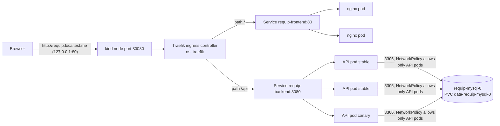
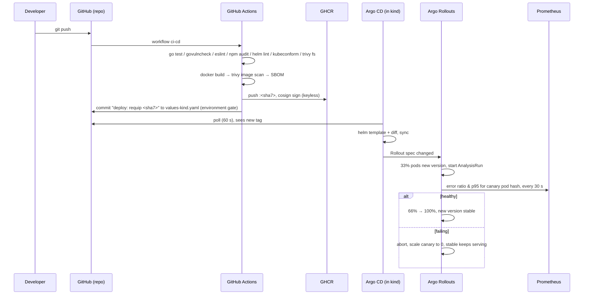
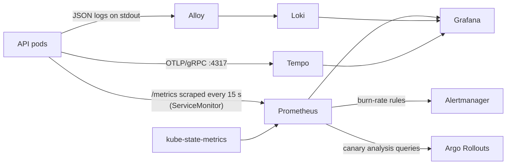

# Architecture

## Components

| Component | Workload | Why this workload |
|---|---|---|
| **API**: Go/Gin, `requip-backend` | Argo Rollouts `Rollout` (canary), 3–6 replicas, HPA | Stateless, so replicas are interchangeable. A Rollout instead of a Deployment so new versions are tested on a share of pods before full release |
| **SPA**: React built to static files, `requip-frontend` | `Deployment`, 2 replicas, unprivileged nginx | Static files: nothing to roll back except the image, so a plain rolling update is enough |
| **MySQL 8.4**: `requip-mysql` | `StatefulSet`, 1 replica, 2 Gi PVC, headless Service | Needs a stable identity and its own disk that survives restarts and rescheduling |
| **Load generator**: `requip-loadgen` | `Deployment`, 1 replica (kind only) | Synthetic traffic so metrics, SLOs and canary analysis have data in a lab |

## Request path

1. `requip.localtest.me` is public DNS that resolves to 127.0.0.1, so no `/etc/hosts` edits are needed. kind maps 127.0.0.1:80 to NodePort 30080, where Traefik listens.
2. The Ingress sends `/api/*` straight to the API Service and everything else to the SPA. The browser sees one origin, so no CORS is involved in the cluster.
3. The API Service load-balances across **all** ready API pods, stable and canary alike. During a canary, the share of pods running the new version sets the share of traffic it gets.
4. Each API pod's readiness probe (`/readyz`) pings MySQL. If MySQL is down, pods leave the Service endpoints (Traefik stops routing to them), but liveness (`/healthz`) keeps passing, so they are not restarted.

## Delivery path (commit → running pod)

**Traceability:** commit SHA → image tag `<sha7>` → `deploy:` commit in Git → Argo CD revision → `requip_build_info{version,commit}` metric and `/api/v1/version` → the footer in the UI.

## Observability path

- **Metrics:** `http_requests_total` and `http_request_duration_seconds` per route template and status, DB pool stats, and `requip_build_info`. Probes and `/metrics` are excluded from the SLO by the `route=~"/api/.*"` selector.
- **Logs:** one JSON line per request with `trace_id`. Request bodies are never logged, because they contain Aadhaar and PAN numbers.
- **Traces:** HTTP server span → one child span per SQL query (otelsql). In Grafana, a `trace_id` in a log line links to the trace in Tempo, and a trace links back to its logs.

## Failure boundaries

| Failure | Blast radius | What contains it |
|---|---|---|
| One API pod crashes | None for users | Other replicas; readiness removes the pod from the Service; liveness restarts it |
| Bad API release | ≤ 33% of requests for ≤ ~1 min | Canary analysis aborts automatically; `git revert` makes it permanent |
| MySQL pod restarts | Writes and reads fail for ~10–30 s | API pods go NotReady instead of crashing; data persists on the PVC |
| MySQL PVC lost | **Total data loss** | Not handled: no backups or replication in this lab (documented limitation) |
| A kind worker node dies | Pods reschedule | Topology spread across 2 workers, PDB `minAvailable: 2`; MySQL waits for its volume (local-path is node-bound) |
| Argo CD down | No new deploys; running app unaffected | Argo CD is out of the request path |
| Prometheus down | No alerts; canary analysis cannot measure, so the rollout aborts (fails safe) | |

## Networking and isolation

- The `requip` namespace enforces the **restricted** Pod Security Standard.
- **Default-deny NetworkPolicies:** the SPA accepts traffic only from Traefik. The API accepts traffic from Traefik, Prometheus (monitoring namespace) and the load generator, and may only talk to MySQL:3306, Tempo:4317 and DNS. MySQL accepts traffic only from API pods.
- All host ports bind to `127.0.0.1`.
