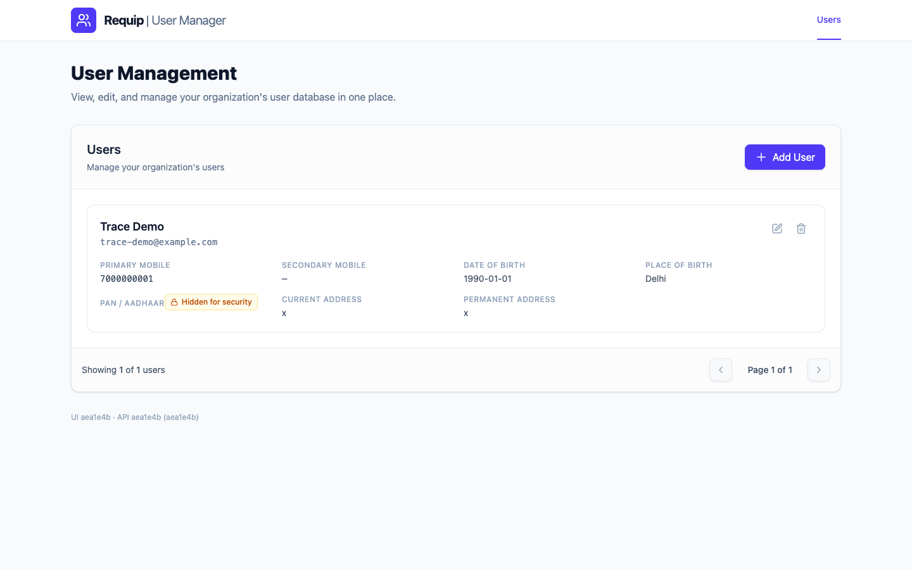
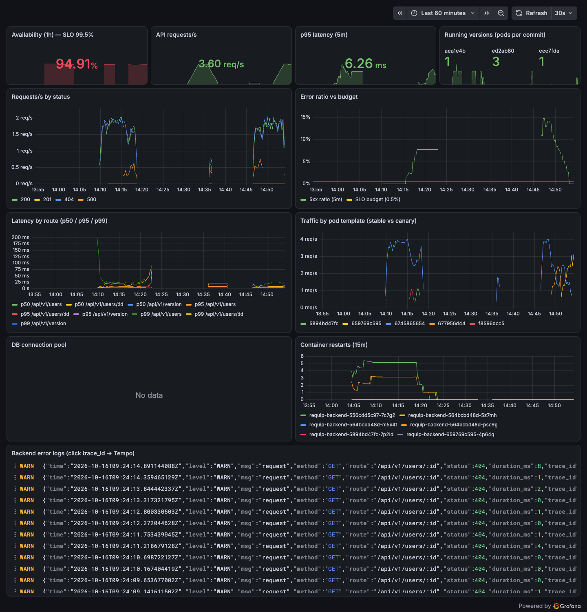
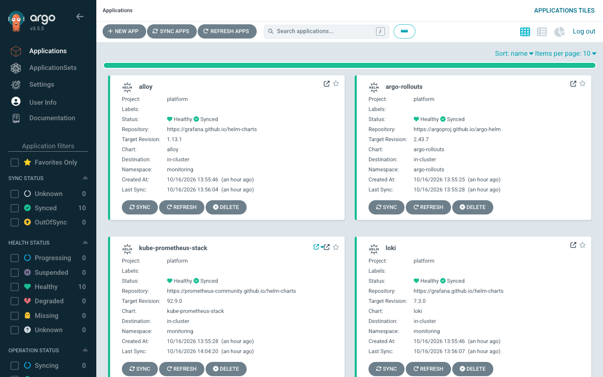

# Evidence

Everything below comes from this repository's real pipeline and a real local kind cluster on 16 October 2026. Raw command output is in [`docs/evidence/`](evidence/). Times are UTC.

- **Tested version:** `ed2ab80` (backend and frontend images `ghcr.io/bhav0207/requip-*:ed2ab80`), deployed by commit `deploy: requip ed2ab80 to kind`. The final PR commit may be newer; see the PR description for the exact final commit and its deployed tag.

## 1. Source → pipeline → image → Git → cluster (one traced change)

The change `aea1e4b` (fix for the tracing crash, see section 6) followed the whole path:

| Step | Evidence |
|---|---|
| Commit | [`aea1e4b`](https://github.com/BHAV0207/Requip-Assignment-/commit/aea1e4b) |
| Pipeline run | [run 38874717737](https://github.com/BHAV0207/Requip-Assignment-/actions/runs/38874717737): backend tests and govulncheck ✔, frontend lint/build/audit ✔, helm lint, kubeconform and Trivy repo scan ✔, both images built, Trivy-scanned, SBOM'd, pushed and cosign-signed ✔, release job ✔ |
| GitOps commit by CI | `42e4abf deploy: requip aea1e4b to kind [skip ci]`, which changes only `deploy/helm/requip/values-kind.yaml` |
| Argo CD sync and canary | Rollout revision 3, AnalysisRun **Successful (10/10 measurements)**, then promoted to 100% |
| Running version | `GET /api/v1/version` → `{"version":"aea1e4b","commit":"aea1e4b816b3…"}`. `requip_build_info{version="aea1e4b"}` on all 3 pods. UI footer shows `UI aea1e4b · API aea1e4b` |

Pipeline history on the PR branch, including one run the image gate **blocked**:

| Commit | Result | Note |
|---|---|---|
| `b5fe216` | ✖ failure | Trivy image scan blocked the frontend image: base `nginx-unprivileged:1.27-alpine` had 41 fixable HIGH/CRITICAL CVEs. **Nothing was pushed.** |
| `f46f4d3` | ✔ | New base image `1.30-alpine3.24-slim`: 0 findings. First image published and deployed |
| `05a2cc7`, `f75e28b`, `3f39a75` | ✔ | Platform ordering fixes (see section 6) |
| `aea1e4b` | ✔ | Tracing crash fix |
| `eee7fda` | ✔ | Deliberately bad release (section 4) |
| `ed2ab80` | ✔ | Revert of the bad release |

## 2. Working user journey (through the real ingress)

[`evidence/01-smoke-test.txt`](evidence/01-smoke-test.txt) shows the following against `http://requip.localtest.me`:
- The frontend returns HTTP 200.
- The API version matches the tag in Git.
- A user is created, read back, updated and deleted, and the deleted user then returns 404.

The same check passed again after recovery from the bad release ([`05-smoke-after-recovery.txt`](evidence/05-smoke-after-recovery.txt)).

## 3. Observability: metrics, logs, traces

- **Metrics** ([`02-metrics.txt`](evidence/02-metrics.txt)):
  - Prometheus scrapes all API pods.
  - `requip_build_info` shows the commit on each pod.
  - The SLO recording rules evaluate (error ratio 0, p95 ≈ 5 ms).
  - All 5 alert rules are loaded.
  - Every series carries `rollouts_pod_template_hash`, which canary analysis uses.
- **Logs → traces** ([`03-logs-and-traces.txt`](evidence/03-logs-and-traces.txt)): a `POST /api/v1/users` log line in Loki carries `trace_id=95fde24d…`. Fetching that trace from Tempo returns **27 spans**: the HTTP server span, then the 4 uniqueness-check `SELECT`s, the `INSERT` and the commit. SQL appears with `?` placeholders only, so no PII ends up in traces.

The dashboard's 1-hour availability (94.91%) is **real**: it includes the crash-loop, the bad-release and the database experiments below. That is the SLO doing its job, not a measurement error.

## 4. Release control: bad release caught and rolled back automatically

**Experiment:** commit `eee7fda` set `FAULT_ERROR_RATE=0.5` (50% of API requests fail) and went through the normal path: Git → CI → GitOps bump → Argo CD → canary.

From [`07-bad-release-canary-abort.txt`](evidence/07-bad-release-canary-abort.txt):

| Time | Canary error-ratio measurement | Outcome |
|---|---|---|
| 08:46:20 | `[]` (no canary traffic yet) | pass |
| 08:46:50 | **1.00** (all canary requests failing) | fail 1 |
| 08:47:20 | **0.55** | fail 2 > `failureLimit` 1 → `RolloutAborted` |

- The canary ReplicaSet was scaled to 0, and stable `aea1e4b` kept serving all traffic. The p95-latency metric stayed healthy (≈ 5 ms), so the error metric alone caught it.
- Revision 4 (the config-only commit synced before CI finished) was aborted the same way. A configuration change gets the same protection as a code change.
- **User impact, from Prometheus:**
  - Total API traffic was about 3.9 req/s, and 5xx peaked at 0.4–0.64 req/s, so about 10–16% of requests failed for about 2 minutes.
  - The 5-minute error ratio peaked at **7.7%**.
  - Without the canary, it would have been 50% until someone noticed.

**Recovery, following [RUNBOOK.md](RUNBOOK.md#high-error-rate):** I ran `git revert` and pushed (`ed2ab80`). From [`08-recovery-after-revert.txt`](evidence/08-recovery-after-revert.txt):
- Revision 7 passed analysis (10/10), was promoted, and is Healthy on 3/3 pods.
- Revision 6 was superseded mid-canary by the newer CI tag, and Rollouts restarted the canary for the newest spec.
- The smoke test passes.

## 5. Reliability: database failure

From [`06-database-failure.txt`](evidence/06-database-failure.txt).

**Hypothesis:** if MySQL dies, API pods fail readiness but are **not** restarted, data survives, and recovery needs no action.

| Time | `GET /users` | API pods ready | MySQL ready |
|---|---|---|---|
| 09:23:38 | 200 | 3/3 | yes (pod deleted) |
| 09:23:43 | 500 | 3/3 | no |
| 09:23:48 | 500 | 1/3 | no |
| 09:23:53 | 200 | 3/3 | yes |

**Result:**
- API restarts stayed at **0** on all pods.
- The user count was the same before and after, because the PVC `data-requip-mysql-0` was reused.
- Service recovered in about **15 s** with no intervention.

**What this showed:** readiness takes *individual* broken pods out of rotation, but when every pod depends on the same database there is no healthy pod left. Users therefore saw about 10 s of HTTP 500. Reducing that needs MySQL replication or failover (see README limitations), not more API replicas.

## 6. Problems found and fixed during the work

Each problem below follows symptom → evidence → cause → change → verification.

| Symptom | Evidence | Cause | Change | Verified by |
|---|---|---|---|---|
| CI blocked the frontend image | Trivy: 41 fixable HIGH/CRITICAL CVEs in Alpine 3.21.3 | Outdated nginx base | `nginx-unprivileged:1.30-alpine3.24-slim` | Trivy 0 findings; CI green (`f46f4d3`) |
| CSP and X-Frame headers missing on pages | `curl -I` showed no CSP on `/users/x` | nginx drops inherited `add_header` in a location that has its own `add_header` | Use `expires` for caching | `curl -I` shows the headers on every route |
| Reachable Go vulnerabilities | `govulncheck`: 13 reachable (stdlib, x/net, pgx, ch-go) | Go 1.27.1 toolchain; the gorm OTel plugin pulled in Postgres and ClickHouse drivers the app never uses | Build with Go 1.27 latest; replace the plugin with `otelsql` | `govulncheck`: 0 reachable |
| Argo CD apps stuck "Unknown" | `Application referencing project platform which does not exist` | AppProjects in wave 0, Applications in wave −3 | AppProjects in wave −10 | All apps created |
| Traefik / Rollouts would not render | `You have to deploy monitoring.coreos.com/v1 first` | ServiceMonitor CRDs came with kube-prometheus-stack in a later wave | Separate `prometheus-operator-crds` app in wave −5 | All apps Synced |
| Traefik "Progressing" forever | Service `LoadBalancer` with `<pending>` IP | Chart 42 moved the key to `service.spec.type` | `service.spec.type: NodePort` and an ingress status address | Healthy |
| **API CrashLoopBackOff in the cluster only** | Log: `tracing setup failed: conflicting Schema URL 1.43.0 and 1.26.0` | semconv version mismatch, only reached when an OTLP endpoint is set | Schemaless resource; tracing failure degrades instead of exiting; **regression test** (fails on old code, passes on new) | Rollout revision 3 Healthy; traces visible in Tempo |

## 7. Security controls verified in the running cluster

From [`04-security-controls.txt`](evidence/04-security-controls.txt):

- **Pod Security Admission:** a privileged pod in `requip` is **rejected** (`violates PodSecurity "restricted:latest"`).
- **NetworkPolicy:** the load generator reaches the API (HTTP 200), but connections to MySQL:3306 and to the internet **time out**, i.e. they are blocked.
- **API container:**
  - UID 65532, `runAsNonRoot`, read-only root filesystem, all capabilities dropped, no service-account token
  - No shell in the image (`exec: "sh": executable file not found`)
- **Secrets:** `DB_PASSWORD` comes from `secretKeyRef` `requip-db`, so the value is not in the manifest, Git or the image.
- **Drift correction** ([`09-drift-correction.txt`](evidence/09-drift-correction.txt)): `kubectl scale deploy requip-frontend --replicas=0` was reverted by Argo CD self-heal. The replica count was restored in about 6 s and both pods were ready in about 11 s.
- **Argo CD project `requip`:** limited to this repo and the `requip` namespace, with no cluster-scoped resources.
- **CI:** Trivy secret scan on every run, images pushed only after the scan, signed with cosign (keyless), and an SBOM uploaded as a build artifact.

## Limitations of this evidence

- It all comes from a single-laptop kind cluster. Throughput numbers are for synthetic load (about 4 req/s from the load generator), not capacity testing.
- Prometheus has no samples from about 08:49 to 09:15. Nothing in the cluster was scraped during that window, most likely because the host machine paused. The canary abort itself completed before the gap.
- The `kind-local` environment had no required reviewers configured during these runs. Adding them makes the release job wait for approval, which was not exercised here.
